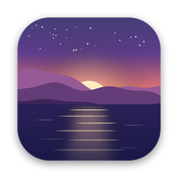
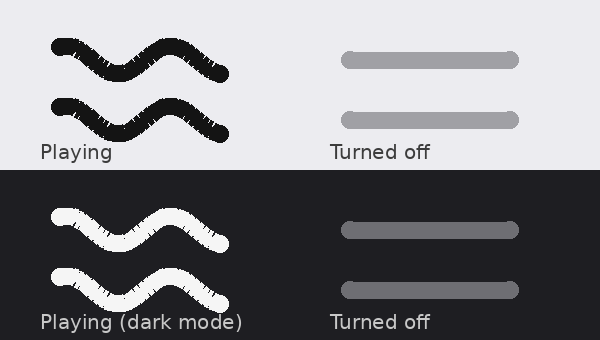

<p align="center">
  
</p>

<h1 align="center">Driftwall</h1>

<p align="center">
  A tiny macOS menu-bar app that turns any video into a live, looping desktop wallpaper.
</p>

---

## Features

- **Any video as wallpaper:** pick an `.mp4`, `.mov` or other video and it plays behind your desktop icons on every screen, looping seamlessly.
- **Menu-bar control:** turn the wallpaper on or off, pause it, or swap the video from one small icon.
- **Animated menu-bar icon:** two waves drift slowly while the wallpaper plays and go flat when it's off.
- **Battery-friendly:** playback pauses automatically when the display sleeps or a full-screen app covers the desktop. Video is always muted.
- **Open at Login:** starts with your Mac (can be turned off from the menu).
- **Multi-monitor:** covers every connected display and adapts when screens are added or removed.
- **Universal:** runs natively on Apple Silicon and Intel Macs.

<p align="center">
  
</p>

## Requirements

- macOS 12 Monterey or later (the *Open at Login* toggle needs macOS 13+)
- Xcode Command Line Tools to build: `xcode-select --install`

## Build & install

1. Clone the repo:
   ```bash
   git clone https://github.com/TharinduWijayarathna/drift-wall.git
   cd drift-wall
   ```
2. Build. Either double-click **`Build Driftwall DMG.command`** in Finder, or run:
   ```bash
   ./scripts/build-dmg.sh
   ```
   This compiles a universal `Driftwall.app`, signs it locally, and creates **`dist/Driftwall.dmg`**.
3. Open the DMG, drag **Driftwall** into **Applications**, and launch it from there.
4. On first launch, pick a video. Driftwall stores a copy in `~/Library/Application Support/Driftwall/`, so the original can be moved or deleted.

> Driftwall isn't notarized by Apple. If you copy the DMG to another Mac, the first launch needs **right-click → Open**.

## Usage

Click the wave icon in the menu bar:

| Menu item | What it does |
| --- | --- |
| **Turn Off / Turn On Wallpaper** | Removes or restores the live wallpaper (your normal wallpaper shows when off) |
| **Pause / Resume Animation** | Freezes the video on the current frame |
| **Choose Video…** | Picks a new video |
| **Open at Login** | Starts Driftwall automatically when you log in |
| **Quit Driftwall** | Quits the app; the live wallpaper stops until you open it again |

## Project structure

```
drift-wall/
├── Sources/
│   └── Driftwall.swift          # The whole app (AppKit + AVFoundation)
├── Resources/
│   ├── AppIcon.png              # Full-bleed icon (macOS 26+ rounds it automatically)
│   └── AppIcon-rounded.png      # Pre-rounded icon for macOS 12–15
├── scripts/
│   └── build-dmg.sh             # Builds the .app and packages dist/Driftwall.dmg
├── docs/                        # Images used in this README
├── Build Driftwall DMG.command  # Double-click wrapper for scripts/build-dmg.sh
└── README.md
```

`build/` and `dist/` are generated by the build script and are git-ignored.

## How it works

Driftwall creates a borderless, click-through window on each screen at the desktop window level, just above the system wallpaper and below your desktop icons. Each window hosts an `AVPlayerLayer` that shares one muted `AVQueuePlayer`, and `AVPlayerLooper` makes the loop seamless. The app watches for window occlusion and sleep/wake notifications to pause playback when nobody can see it.

## Uninstall

1. Click the menu-bar icon → **Quit Driftwall**.
2. Drag **Driftwall** from Applications to the Trash.
3. Optionally delete `~/Library/Application Support/Driftwall/` (the stored video).

### Removing the old LiveWallpaper prototype

If you used the earlier script-based version, the build script removes it automatically. To remove it by hand:

```bash
launchctl bootout gui/$(id -u)/com.local.livewallpaper
rm ~/Library/LaunchAgents/com.local.livewallpaper.plist
```
